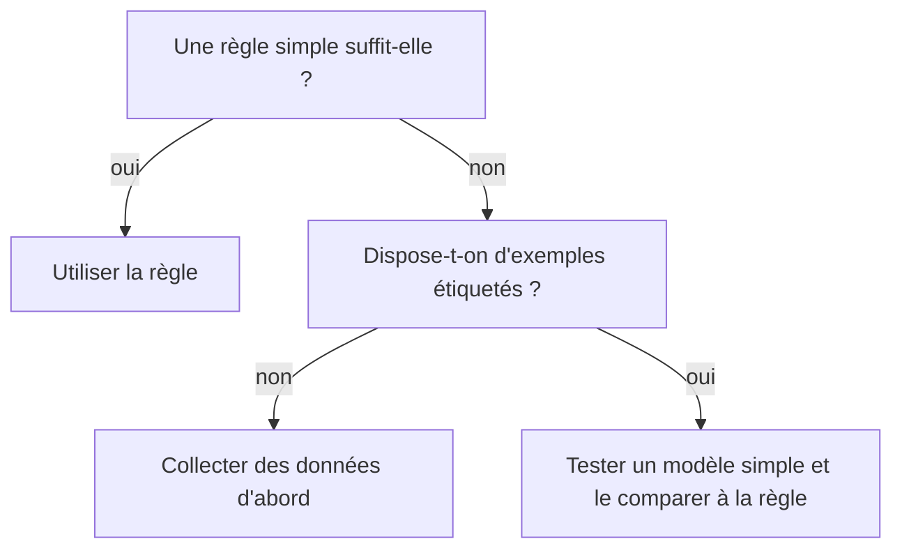

Un projet de machine learning démarre souvent par un enthousiasme communicatif et une phrase vague : « on a plein de données, on devrait en faire quelque chose ». Quelques mois plus tard, l'équipe découvre que les données ne contiennent pas l'information utile, que personne ne sait comment intégrer la prédiction dans le parcours, ou qu'une simple règle aurait suffi.

Ces échecs sont presque toujours prévisibles. Cinq questions, posées avant le premier jour de développement, évitent la majorité des mauvaises surprises.

## Question 1 : quel problème précis voulons-nous résoudre ?

Un projet de ML répond à une **décision** ou à une **prédiction** précise, pas à une ambition générale. Comparez :

- « Améliorer l'expérience client avec l'IA » : trop vague pour être évalué.
- « Prédire, au moment de l'ouverture d'un ticket, la file de traitement adaptée » : testable.

Formulez le problème sous cette forme : *à quel moment, pour qui, quelle prédiction, quelle action en découle ?* Si l'action qui suit la prédiction n'est pas claire, la prédiction ne créera aucune valeur.

## Question 2 : le machine learning est-il nécessaire ?


*Figure 1 : arbre de décision avant de choisir le machine learning.*


Le ML est adapté quand la règle est **difficile à écrire** mais que des **exemples** abondent. Si le raisonnement tient en quelques règles stables, un moteur de règles est plus simple, moins cher, plus facile à expliquer et à maintenir. Si une simple statistique ou un tri suffit, commencez par là.

Une bonne pratique consiste à définir une **base de référence** (baseline) très simple, par exemple « toujours prédire la catégorie la plus fréquente » ou une règle manuelle. Un modèle de ML n'a d'intérêt que s'il fait nettement mieux que cette référence.

## Question 3 : disposons-nous des bonnes données ?

C'est la question qui fait le plus souvent dérailler les projets. Vérifiez quatre points :

- **Disponibilité** : peut-on légalement et techniquement y accéder, en tenant compte du consentement et des règles de protection des données personnelles ?
- **Étiquettes** : pour de l'apprentissage supervisé, a-t-on des exemples correctement annotés, et qui les produira ?
- **Représentativité** : les données reflètent-elles les situations réelles, y compris les cas rares et les populations variées ?
- **Stabilité** : le phénomène évoluera-t-il ? Un modèle entraîné sur le passé peut se dégrader quand le contexte change.

Un signal d'alerte : si des experts humains ne parviennent pas eux-mêmes à s'accorder sur la bonne réponse, le modèle aura du mal à apprendre quelque chose de cohérent.

## Question 4 : comment saurons-nous que cela fonctionne ?

Définissez le succès **avant** de construire. Il faut deux niveaux :

- une **métrique technique** (précision, rappel, erreur moyenne…) choisie en fonction du coût des erreurs ;
- un **indicateur produit ou métier** (temps de traitement, taux de résolution, satisfaction).

Précisez aussi le seuil à atteindre pour continuer, et celui qui justifie d'arrêter. Un projet sans critère d'arrêt a tendance à durer indéfiniment.

## Question 5 : comment la prédiction sera-t-elle utilisée, surveillée et corrigée ?

Un modèle n'existe pas seul. Il faut prévoir :

- **l'intégration** : où la prédiction apparaît-elle, qui agit dessus, avec quelle latence ?
- **la gestion des erreurs** : que se passe-t-il quand le modèle se trompe ? Une revue humaine est-elle prévue pour les cas sensibles ?
- **le suivi** : comment détecter une dérive des données ou une baisse de qualité ?
- **la responsabilité** : qui décide, qui répond en cas de problème, quels biais potentiels faut-il tester ?

## Un exemple de mini-cadrage

Prenons un cas fictif de priorisation de demandes entrantes. Une fiche d'une demi-page suffit :

```
Décision : trier les demandes entrantes par urgence
Utilisateur : l'équipe de support, à l'arrivée de la demande
Référence : tri chronologique actuel
Données : historique de demandes avec urgence annotée par les agents
Métrique technique : rappel sur les demandes urgentes
Indicateur métier : délai de première réponse sur les urgences
Seuil de poursuite : meilleur que la référence sur un jeu de test récent
Risque : sous-estimer une urgence ; revue humaine des cas incertains
```

Remplir cette fiche prend une heure et révèle souvent, dès cette étape, ce qui manque.

## À retenir

- Partez d'une décision précise, pas d'une technologie.
- Comparez toujours à une solution simple de référence.
- Les données (accès, étiquettes, représentativité, stabilité) conditionnent la réussite plus que l'algorithme.
- Définissez à l'avance les critères de succès et d'arrêt.
- Prévoyez l'usage, le suivi et la gestion des erreurs dès le départ.

Le module M1 de la formation propose un modèle de fiche de cadrage et des exercices pour l'appliquer à vos propres cas.
